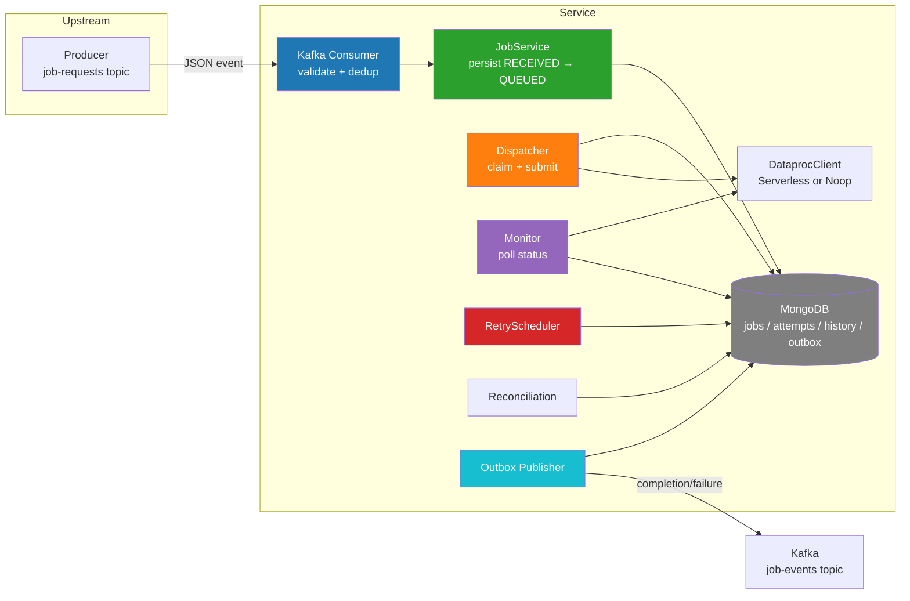
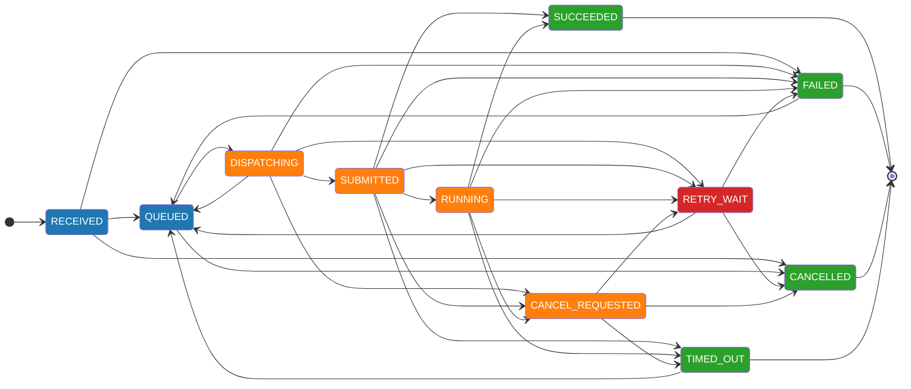
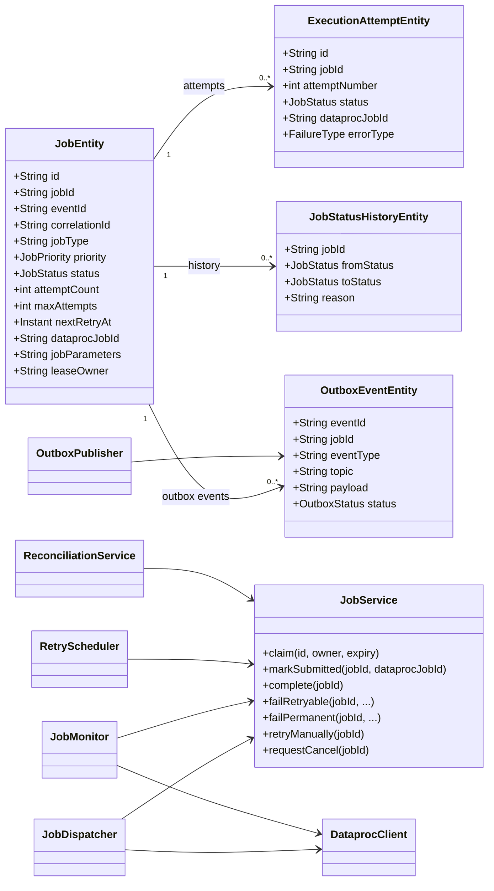

# Architecture

## End-to-end flow



1. A producer writes a JSON request to `job-requests`. The consumer validates, deduplicates on
   `eventId`, persists (RECEIVED → QUEUED) and only then acknowledges the offset.
2. The **Dispatcher** claims queued jobs atomically (MongoDB `findAndModify`) when a concurrency
   slot is free, and submits them to Dataproc asynchronously.
3. The **Monitor** polls Dataproc, maps states, records outcomes and releases slots.
4. The **RetryScheduler** re-queues failed jobs after exponential backoff; the **Outbox
   publisher** relays terminal events to `job-events`; **Reconciliation** recovers interrupted
   dispatches.

## Job lifecycle state machine



**Legend:** orange = holds a concurrency slot · green = terminal · red = retry wait · blue = queued/received.

The `JobStateMachine` is the single source of truth for valid transitions; any write path that
changes a job's status must go through it.

## Domain model (UML)



## Package layout

```
com.dataorchestrator
├── api/            REST controllers + DTOs
├── alert/          AlertService abstraction + logging impl
├── common/         correlation filter, exception handling, domain exceptions
├── config/         properties, Kafka, OpenTelemetry, MongoDB, OpenAPI
├── dataproc/       DataprocClient (Serverless + Noop), SparkJobSpec, SparkJobDefinition
├── job/            documents, repositories, state machine, JobService
├── metrics/        OpenTelemetry metrics
├── outbox/         transactional outbox + publisher
├── request/        Kafka consumer + validation + dedup
└── scheduler/      dispatcher, monitor, retry, reconciliation, concurrency
```

## Reliability design

| Concern | Mechanism |
|---|---|
| Duplicate events | Unique index on `eventId`; repeated deliveries never create a second job |
| Multi-replica concurrency | Atomic `findAndModify` claim; the DB is the single source of truth |
| Idempotent submission | Deterministic Dataproc request id (`jobId-attempt-N`) |
| Lost events on restart | Transactional outbox (MongoDB replica set, see `docker-compose.yml`) |
| Interrupted dispatch | Stale `DISPATCHING` leases reverted to `QUEUED` on startup and periodically |
| Ambiguous submission | Reconciliation + deterministic request id avoid duplicate executions |
| Retry safety | Retries respect concurrency limits and re-enter via the normal dispatcher |
| Metric cardinality | Only low-cardinality labels (job type); never the job id |
